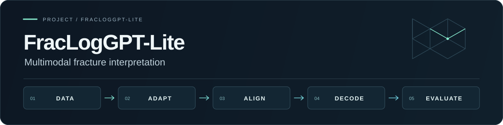

# FracLogGPT-Lite




**面向成像测井裂缝解释的多模态实验工程框架。** 将数据检查、DAPT、LoRA-SFT、DPO / SimPO、视觉对比解码和评测串联为配置驱动的实验流程，重点处理阶段衔接、推理恢复和评测口径等工程问题。

[快速验证](#无-gpu-快速验证) · [工程实现](#工程实现) · [实验设计](#实验设计与结果边界) · [代码导航](#代码导航) · [完整使用指南](docs/QUICKSTART.md)

> **公开版本：** 提供实验代码、配置、测试与合成格式示例，支持无需 GPU 的代码验证。真实测井资料、模型权重与训练产物不随仓库发布。

## 问题与方法

成像测井裂缝解释需要围绕图像描述裂缝数量、位置与形态。本项目以 `Qwen/Qwen3.5-4B` 为轻量模型实验对象，保留 `Qwen/Qwen2.5-VL-7B-Instruct` 基线路径，用统一的数据与评测接口组织以下流程：

```text
数据检查 / 格式转换 / 分层划分
                ↓
领域继续预训练 DAPT → LoRA-SFT → DPO 或 SimPO
                ↓                         ↓
          标准多模态推理            Frac-VCD 对比解码
                └───────────┬─────────────┘
                            ↓
             计数 / 文本标签 / 幻觉分析 / 结果汇总
```

Frac-VCD 对同一提示下的原图与扰动图进行双分支推理，按 `logits_original + α × (logits_original − logits_perturbed)` 融合下一 token 的分数。仓库实现了同步解码、批处理缓存路径与 Hugging Face `generate` 接口路径，支持模糊、灰度和降采样扰动；效果需要在真实测试集上验证。

## 工程实现

| 能力 | 已实现的内容 | 代码入口 |
|---|---|---|
| 配置驱动编排 | E0–E3 阶段命令生成、dry-run、执行状态记录、阶段失败退出 | [`run_pipeline.py`](scripts/run_pipeline.py) |
| Checkpoint 衔接 | 自动发现训练输出、解析阶段占位符、从已有 checkpoint 接续下游阶段 | [`checkpoints.py`](src/fraclog/checkpoints.py) |
| 多模态数据处理 | 图像引用规范化与检查、SFT / 偏好格式转换、固定随机种子的计数分层划分 | [`data.py`](src/fraclog/data.py) |
| 推理恢复 | 按稳定样本键跳过已完成预测、重复结果清理、输出文件互斥锁 | [`predictions.py`](src/fraclog/predictions.py) |
| 视觉对比解码 | 原图 / 扰动图 logits 融合、双分支同步、KV cache 与多模态 token 字段维护 | [`vcd.py`](src/fraclog/vcd.py) |
| 评测与来源区分 | 计数、自动文本标签一致性、文本相似度、过计数 / 欠计数、Bootstrap 置信区间；DAPT 语料来源记录 | [`metrics.py`](src/fraclog/metrics.py) · [`bootstrap_metrics.py`](scripts/bootstrap_metrics.py) · [`dapt.py`](src/fraclog/dapt.py) |

训练算法通过 `ms-swift` 调用，模型与 adapter 加载使用 Transformers / PEFT。仓库的工程价值主要体现在数据、阶段编排、推理辅助与评测实现；依赖项目列于文末。

## 无 GPU 快速验证

使用 Python 3.10 或以上版本，在仓库根目录执行以下 PowerShell 命令。无需私有数据、模型权重或完整训练依赖：

```powershell
$env:PYTHONPATH = (Resolve-Path src).Path
python -m unittest discover -s tests

python scripts/run_pipeline.py --config configs/e1_qwen35_4b_lora_dpo.json --swift-wrapper scripts/run_swift_cli.py
```

单元测试验证公共代码路径。未安装 `torch` 时，VCD 张量测试自动跳过；安装 `torch` 后可在 CPU 上运行这些单元测试。上述 dry-run 会打印 DAPT → SFT → DPO → 推理命令，并将命令和状态写入 `outputs/`，不会启动训练或下载模型。尚无 checkpoint 时，命令中的占位符会保留。

完整安装、E2 / E3 dry-run、数据准备和 GPU 实验入口见 **[使用指南](docs/QUICKSTART.md)**。`smoke_local.py` 依赖本地私有数据，需完成数据准备后再运行。

## 实验设计与结果边界

| 实验 | 基座与路径 | 待验证的问题 |
|---|---|---|
| E0 | Qwen2.5-VL-7B + DAPT + LoRA-SFT + DPO | 接入或复现原始 FracLogGPT 基线 |
| E1 | Qwen3.5-4B + DAPT + LoRA-SFT + DPO | 4B 模型替代 7B 基线的可行性 |
| E2 | Qwen3.5-4B + DAPT + LoRA-SFT + SimPO | SimPO 与 DPO 在同一偏好数据上的差异 |
| E3 | E2 checkpoint + Frac-VCD | 推理端视觉对比对计数、零裂缝幻觉和形态描述的影响 |

E0–E3 是实验设计，当前仓库暂未公开可复核的模型效果表。训练完成状态与性能收益需通过相应实验确认。解读评测时需保留以下条件：

- **论文引用与本地结果分开。** [`paper_baseline.py`](src/fraclog/paper_baseline.py) 保存的是论文报告的 E0 数值，并明确标记 `same_test_set=False`；不能作为本项目复现成绩或与不同测试集直接计算提升。
- **自动标签指标有明确口径。** `LocAcc` / `MorphAcc` 比较从参考文本与预测文本解析出的标签，不等同于专家视觉评审；Count 指标按 `0 / 1 / 2 / >=3` 四类计算宏平均。
- **格式示例不代表模型表现。** [`examples/`](examples/) 是合成数据格式参考。完整实验需要本地合法可用的数据、领域语料、模型权重与 GPU 环境。

进一步的指标说明、资源测量参数和 DAPT 语料政策见 [使用指南](docs/QUICKSTART.md)。

## 代码导航

| 想了解的部分 | 建议阅读 |
|---|---|
| 如何从配置串联实验 | [`configs/`](configs/) → [`run_pipeline.py`](scripts/run_pipeline.py) → [`run_ms_swift.py`](scripts/run_ms_swift.py) |
| 如何转换数据并生成评测输入 | [`DATA_SCHEMA.md`](docs/DATA_SCHEMA.md) → [`convert_data.py`](scripts/convert_data.py) → [`data.py`](src/fraclog/data.py) |
| 如何构造多轮图像提示与恢复推理 | [`inference.py`](src/fraclog/inference.py) → [`infer_transformers.py`](scripts/infer_transformers.py) → [`predictions.py`](src/fraclog/predictions.py) |
| 如何实现视觉对比解码 | [`vcd.py`](src/fraclog/vcd.py) → [`infer_frac_vcd.py`](scripts/infer_frac_vcd.py) → [`test_vcd.py`](tests/test_vcd.py) |
| 如何评测与汇总 | [`evaluate_predictions.py`](scripts/evaluate_predictions.py) → [`bootstrap_metrics.py`](scripts/bootstrap_metrics.py) → [`summarize_results.py`](scripts/summarize_results.py) |
| 如何检查公开代码行为 | [`tests/`](tests/)：数据转换、分层划分、指标、checkpoint、推理消息与预测恢复等 |

```text
configs/       实验与 smoke 配置
docs/          使用指南、数据格式、公开范围
examples/      合成格式示例
scripts/       转换、编排、推理、评测入口
src/fraclog/   可复用 Python 模块
tests/         公共代码路径的单元测试
```

数据、模型、实验输出与第三方源码目录默认不纳入 Git。公开发布范围与检查命令见 [REPOSITORY_SCOPE.md](docs/REPOSITORY_SCOPE.md)、[SECURITY.md](SECURITY.md) 和 [使用指南](docs/QUICKSTART.md)。

## 依赖与参考项目

[ms-swift](https://github.com/modelscope/ms-swift) · [SimPO](https://github.com/princeton-nlp/SimPO) · [VCD](https://github.com/DAMO-NLP-SG/VCD) · [Transformers](https://github.com/huggingface/transformers) · [PEFT](https://github.com/huggingface/peft) · [vLLM](https://github.com/vllm-project/vllm)

## English Abstract

FracLogGPT-Lite is a multimodal experiment engineering framework for fracture interpretation from imaging-log data. It provides configuration-driven DAPT, LoRA-SFT, DPO / SimPO orchestration, checkpoint handoff, resumable Transformers inference, visual contrastive decoding, and evaluation utilities. Public code paths can be checked with unit tests and command dry-runs without private data or a GPU. E0–E3 describe the experimental design; model performance, efficiency gains, and hallucination reduction are not established by the public repository. Real data, annotations, weights, checkpoints, predictions, and experimental results are not included.
